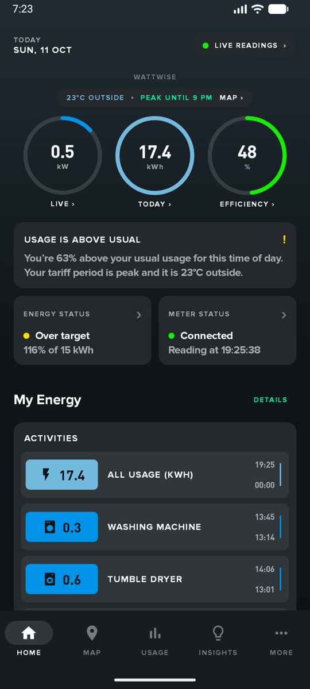
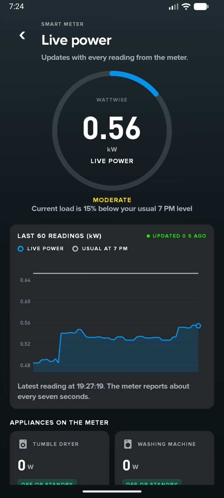
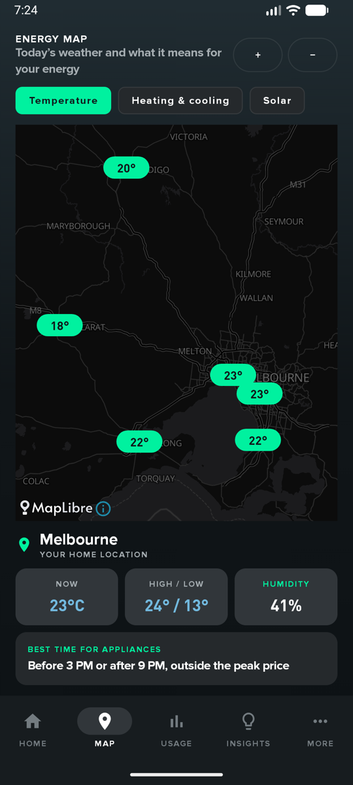
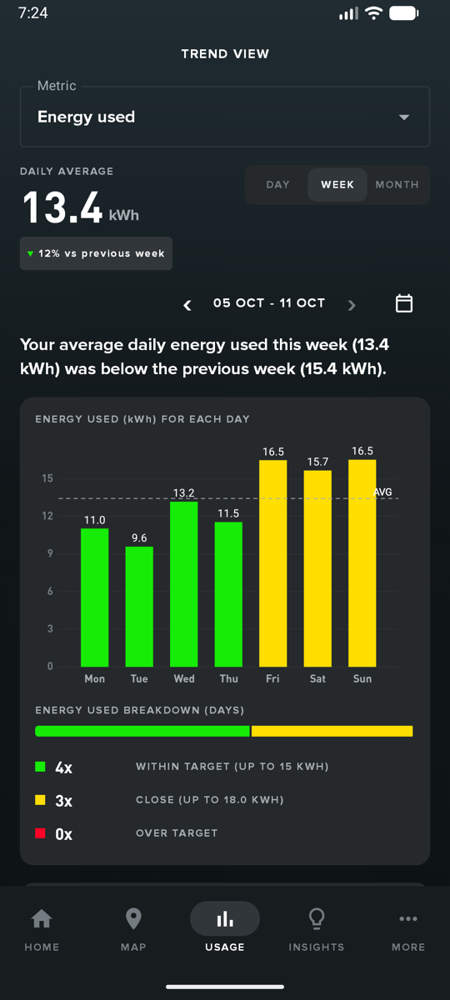
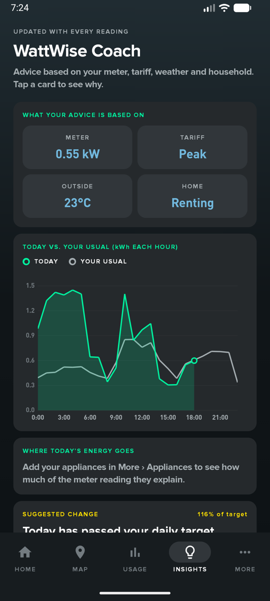
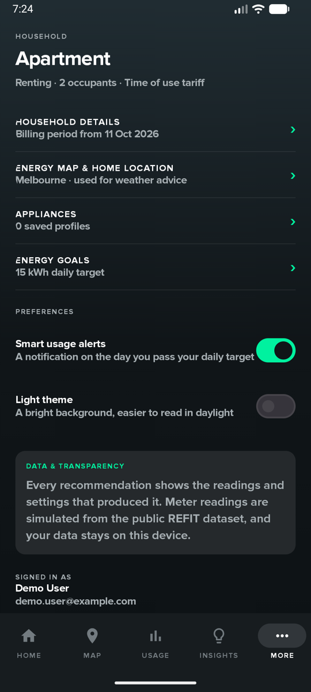
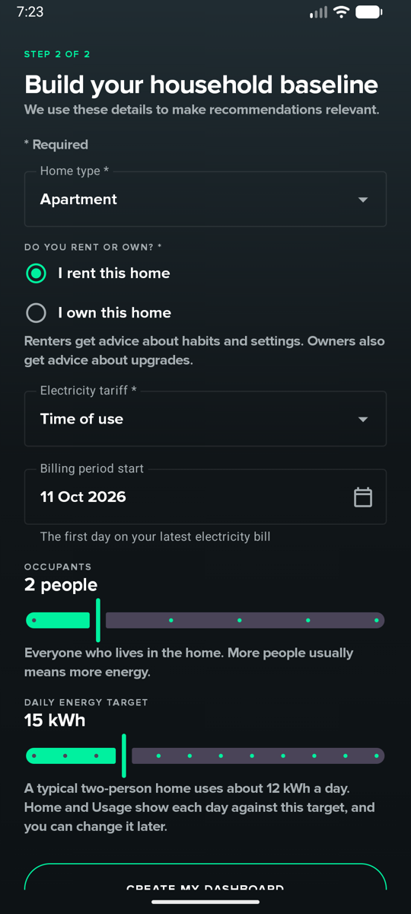

# WattWise

WattWise is an Android app that helps a household understand and reduce its electricity use. The UI is inspired from Whoop.

The app shows how much power the home uses now, how today compares with a normal day, and what to change to save energy.

## Screenshots

| Home | Live power | Energy map |
| :---: | :---: | :---: |
|  |  |  |

| Usage | Insights | More |
| :---: | :---: | :---: |
|  |  |  |

| Household setup |
| :---: |
|  |

## What the app does

**Home.** Shows the live power, the energy used today and an efficiency score. A message tells you if your usage is above or below your usual level.

**Live power.** Shows each new reading from the smart meter. A chart compares the last 60 readings with your usual level for this hour.

**Energy map.** Shows the weather near your home on a map. You can change the layer to temperature, heating and cooling, or solar. You can use the location of your device or tap a point. Tap Plan to find the cheapest time to start an appliance and to set a daily reminder.

**Usage.** Shows your energy use for a day, a week or a month. The bars use colour to show the days that are within your target, near your target or over your target.

**Insights.** The WattWise Coach gives advice. Each piece of advice uses your meter reading, your tariff, the weather and your household details. Tap a card to see the reason for the advice.

**Bill forecast.** Estimates the bill for the current billing period and compares it with your budget. It tells you how much energy to use each day to stay in the budget.

**More.** Change your household details, home location, appliances and budget. You can also set the usage alerts and the light theme here.

**Sign-in and setup.** Create an account with an email address and a password, or sign in with Google. Then enter your home type, tariff, number of occupants and daily energy target.

**Notifications.** The app sends a notification on the day you go over your daily target. It can also send a reminder each day before the cheapest time to start an appliance.

## About the data

An emulator has no smart meter, so the app simulates one. It reads one day of the public REFIT dataset from the `assets` folder and sends a new reading about every seven seconds.

The weather comes from the Open-Meteo API. The map tiles come from OpenFreeMap.

Your household details, appliances and usage history are saved on the device. The household, appliances and reminder are also backed up to Cloud Firestore, so they return if you install the app again.

## How it is built

| Part | Technology |
| --- | --- |
| Language | Kotlin |
| User interface | Jetpack Compose and Material 3 |
| Navigation | Navigation Compose |
| Local database | Room |
| Weather data | Retrofit and Gson (Open-Meteo API) |
| Sign-in | Firebase Authentication (email and Google) |
| Cloud backup | Cloud Firestore |
| Background work | WorkManager |
| Reminders | AlarmManager |
| Map | MapLibre |
| Charts | MPAndroidChart |

The code uses the MVVM pattern. Each screen gets its data from a ViewModel. Each ViewModel gets its data from a repository.

```
app/src/main/java/edu/monash/wattwise/
├── data/         Room database, Retrofit service, meter simulator, repositories
├── viewmodel/    One ViewModel for each data area
├── ui/           Screens, shared components and theme
├── navigation/   Routes, navigation graph and bottom bar
├── worker/       Daily usage check (WorkManager)
├── reminder/     Appliance reminder (AlarmManager)
├── utils/        Calculations, formatters and validators
└── constants/    Fixed values used across the app
```

## How to run the app

1. Open the project in Android Studio.
2. Wait for the Gradle sync to complete.
3. Start an emulator or connect a phone with Android 8.0 (API 26) or later.
4. Select **Run**.
5. Create an account, then complete the two setup steps.

The device must have an internet connection for sign-in, weather and the map.

## Team

FIT5046 Semester 2, 2026 — Group 111
